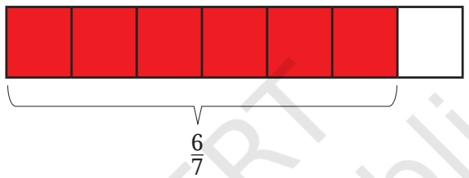
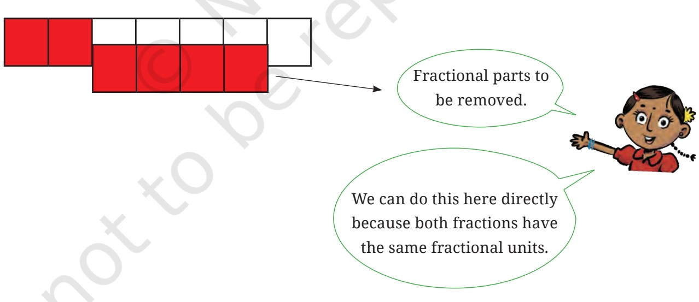

## Subtraction of fractions with the same fractional unit or denominator

Brahmagupta’s method also applies when subtracting fractions!

Let us start with the problem of subtracting $\frac { 4 } { 7 }$ from ${ \frac { 6 } { 7 } } ,$ i.e., what is $\frac { 6 } { 7 } - \frac { 4 } { 7 } ?$

To solve this problem, we can again use the rectangular strips. In both fractions, the fractional unit is the same, i.e., ${ \frac { 1 } { 7 } } .$ . Let us first represent the bigger fraction using a rectangular strip model as shown:

Each shaded part represents ${ \frac { 1 } { 7 } } .$ Now, we need to subtract ${ \frac { 4 } { 7 } } .$ To do this let us remove 4 of the shaded parts:

So, we are left with 2 shaded parts, i.e., $\frac { 6 } { 7 } - \frac { 4 } { 7 } = \frac { 2 } { 7 }$

Try doing this same exercise using the number line.