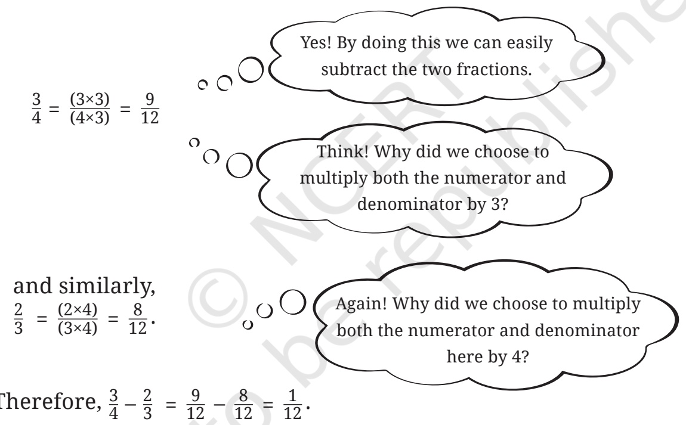

**Figure it Out** 1. $\frac{5}{8} - \frac{3}{8}$ 2. $\frac{7}{9} - \frac{5}{9}$ 3. $\frac { 1 0 } { 2 7 } - \frac { 1 } { 2 7 }$

**Subtraction of fractions with different fractional units or denominators**

**Example**: What is $\frac { 3 } { 4 } - \frac { 2 } { 3 } ?$

As we already know the procedure for subtraction of fractions with the same fractional units, let us convert each of the given fractions into equivalent fractions with the same fractional units.

Yes! By doing this we can easily subtract the two fractions.

Think! Why did we choose to multiply both the numerator and denominator by 3?

Again! Why did we choose to multiply both the numerator and denominator here by 4?

Therefore, $\frac{3}{4} - \frac{2}{3} = \frac{9}{12} - \frac{8}{12} = \frac{1}{12}$

**Brahmagupta’s method for subtracting two fractions —**

1. Convert the given fractions into equivalent fractions with the same fractional unit, i.e., the same denominator.

2. Carry out the subtraction of fractions having the same fractional units. This can be done by subtracting the numerators and keeping the same denominator.

3. Simplify the result into lowest terms if needed.