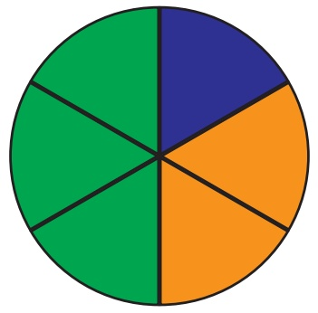

another fractional unit, that is different from ${ \frac { 1 } { 2 } } ,$ is to replace it by ${ \frac { 1 } { 3 } } .$ So two of the fractions must be $\frac { 1 } { 2 }$ and $\frac { 1 } { 3 } !$ What must be third fraction then, so that the three fractions add up to 1?

This explains why there is only one solution to the above problem.

$$
{ \frac { 1 } { 2 } }   +   { \frac { 1 } { 3 } }   +   { \frac { 1 } { 6 } }   =   1
$$

What if we look for four different fractional units that add up to 1?

2.  Can you find four different fractional units that add up to 1?

It turns out that this problem has six solutions! Can you find at least one of them? Can you find them all? You can try using similar reasoning as in the cases of two and three fractional units — or find your own method!

Once you find one solution, try to divide a circle into parts like in the figure above to visualise it!