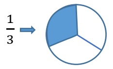
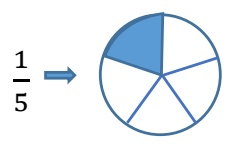
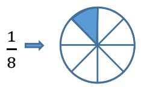

b.

$\frac{1}{4} + \frac{1}{4} + \frac{1}{4} + \frac{1}{4} + \frac{1}{4} + \frac{1}{4} + \frac{1}{4} + \frac{1}{4} + \frac{1}{4} = \frac{9}{4} = 9$ 1 times quarter = 2 + 4

**Q5. Match each fractional unit with the correct picture:**

$\frac{1}{6}$ $\frac{1}{8}$ $\frac{1}{5}$ $\frac { 1 } { 3 }$

Ans.

**Section 7.4**

**Page no. 159**

**Q1. Here, the fractional unit is dividing a length of 1 unit into three equal parts. Write the fraction that gives the length of the blue line in the box or in your notebook.**

Ans. $\frac{2}{3}$

**Q2. Here, a unit is divided into 5 equal parts. Write the fraction that gives the length of the blue lines in the respective boxed or in your notebook.**

Ans. $\frac{2}{5}, \frac{4}{5}$