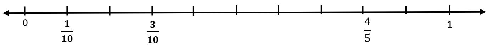

**Q3. Now, a unit is divided into 8 equal parts. Write the appropriate fractions in your notebook.**

Ans. $\frac { 1 } { 8 } , \frac { 2 } { 8 } , \frac { 3 } { 8 }$ ,… •

**Page no. 160**

**Figure it out**

**Q1. On a number line, draw lines of lengths** $\frac{1}{10}, \frac{3}{10}$ **and** $\frac { 4 } { 5 } .$

Ans.

**Q3. How many fractions lie between 0 and 1? Think, discuss with your classmates, and write your answer.**

Ans. Uncountable number of fractions

**Q4. What is the length of the blue line and black line shown below? The distance between 0 and 1 is 1 unit long, and it is divided into two equal parts. The length of each part** is ${ \frac { 1 } { 2 } } .$ So the blue line is $\frac { 1 } { 2 }$ **units long. Write the fraction that gives the length of the black line in the box.**

Ans. $\frac { 3 } { 2 }$

**Q5. Write the fraction that gives the lengths of the black lines in the respective boxes.**

Ans. $\frac{6}{5}, \frac{7}{5}, \frac{8}{5}, \frac{9}{5}$

**Section 7.5**

**Page No. 162**

**Figure it out**

**Q1. How many whole units are there in** $\frac { 7 } { 2 } ?$

Ans. There are 3 whole units in $\frac { 7 } { 2 }$

**Q2. How many whole units are there in** $\frac{4}{3}$ **and in** $\frac { 7 } { 3 } ?$

Ans. There is 1 whole unit in $\frac{4}{3}$ and 2 whole units in $\frac { 7 } { 3 } .$