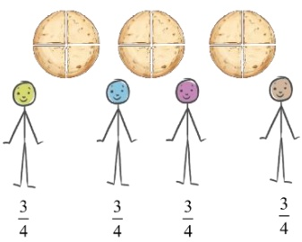
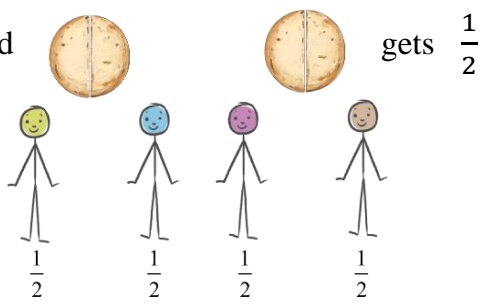

**Q3 .** $\frac{4}{6} = \frac{4}{6} = \frac{4}{6} = \frac{4}{6} = \frac{4}{6} = \frac{4}{6} = \frac{4}{6} = \frac{4}{6} = \frac{4}{6} = \frac{4}{6} = \frac{4}{6} = \frac{4}{6} = \frac{4}{6} = \frac{4}{6} = \frac{4}{6} = \frac{4}{6} = \frac{4}{6} = \frac{4}{6} = \frac{4}{6} = \frac{4}{6} = \frac{4}{6} = \frac{4}{6} = \frac{4}{6} = \frac{4}{6} = \frac{4}{6} = \frac{4}{6} = \frac{4}{6} = \frac{4}{6} = \frac{4}{6} = \frac{4}{6} = \frac{4}{6} = \frac{4}{6} = \frac{4}{6} = \frac{4}{6} = \frac{4}{6} = \frac{4}{6} = \frac{4}{6} = \frac{4}{6} = \frac{4}{6} = \frac{4}{6} = \frac{4}{6} = \frac{4}{6} = \frac{4}{6} = \frac{4}{6} = \frac{4}{6} = \frac{4}{6} = \frac{4}{6} = \frac{4}{6} = \frac{4}{6} = \frac{4}{6} = \frac{4}{6} = \frac{4}{6} = \frac{4}{6} = \frac{4}{6} = \frac{4}{6} = \frac{4}{6} = \frac{4}{6} = \frac{4}{6} = \frac{4}{6} = \frac{4}{6} = \frac{4}{6} = \frac{4}{6} = \frac{4}{6} = \frac{4}{6} = \frac{4}{6} = \frac{4}{6} = \frac{4}{6} = \frac{4}{6} = \frac{4}{6} = \frac{4}{6} = \frac{4}{6} = \frac{4}{6} = \frac{4}{6} = \frac{4}{6} = \frac{4}{6} = \frac{4}{6} = \frac{4}{6} = \frac{4}{6} = \frac{4}{6} = \frac{4}{6} = \frac{4}{6} = \frac{4}{6} = \frac{4}{6} = \frac{4}{6} = \frac{4}{6} = \frac{4}{6} = \frac{4}{6} = \frac{6}{6} = \frac{4}{6} = \frac{6}{6} = \frac{6}{6} = \frac{6}{6} = \frac{6}{6} = \frac{6}{6} = \frac{6}{6} \frac{6}{6} = \frac{6}{6} = \frac{6}{6} = \frac{6}{6} \frac{6}{6} = \frac{6}{6} \frac{6} = \frac{6}{6} \frac{6}{6} = \frac{6}{6} \frac{6}{6} = \frac{6} \frac{6}{6} \frac{6}{6} = \frac{6}{6} \frac{6}{6} \frac{6} \frac{6}{6} = \frac{6}{6} \frac{6}{6} \frac{6}{6} \frac{6} \frac{6}{6} \frac{6} \frac{6}{6} \frac{6}{6} \frac{6} \frac{6}{6} \frac{6}{6} \frac{6} \frac{6}{6} \frac{6}{6} \frac{6} \frac{6}{6} \frac{6} \frac{6}{6} \frac{6}{6} \frac{6} \frac{6}{6} \frac{6}{6} \frac{6} \frac{6}{6} \frac{6} \frac{6}{6} \frac{6} \frac{6}{6} \frac{6}{6} \frac{6} \frac{6}{6} \frac{6} \frac{6}{6} \frac{6} \frac{6}{6} \frac{6}{6} \frac{6} \frac{6}{6} \frac{6} \frac{6}{6} \frac{6}$ **(Write as many as you can)**

Ans. $\frac{4}{6} = \frac{2}{3} = \frac{6}{9} = \frac{8}{12} = \frac{10}{15} =$

## Page no. 166

**Figure it out**

**Q1. Three rotis are shared equally by four children. Show the division in the picture and write a fraction for how much each child gets. Also, write the corresponding division facts, addition facts, and, multiplication facts.**

Fraction of roti each child gets is

**Division fact:**

**Addition fact:**

**Multiplication fact:**

**Compare your picture and answers with your classmates!**

Ans. Each child $\operatorname { g e t s } { \frac { 3 } { 4 } } \operatorname { r o t i } .$

Division fact: $3 \div 4 = \frac { 3 } { 4 }$

Addition fact: $3 = \frac{3}{4} + \frac{3}{4} + \frac{3}{4} + \frac{3}{4}$

Multiplication fact: $3 = 4 \times { \frac { 3 } { 4 } }$

**Q2. Draw a picture to show how much each child gets when 2 rotis are shared equally by 4 children. Also, write the corresponding division facts, addition facts, and multiplication facts.**

Ans. 2 Rotis equally shared by 4 children. Each child roti.

Division fact $2 \div 4 = \frac{2}{4} = \frac{1}{2}$

Addition fact: $2 = \frac{1}{2} + \frac{1}{2} + \frac{1}{2} + \frac{1}{2}$

Multiplication fact: $2 = 4 \times \frac { 1 } { 2 }$

**Q3. Anil was in a group where 2 cakes were divided equally among 5 children. How much cake would Anil get?**

Ans. Anil would get $\frac{2}{5}$ cake.