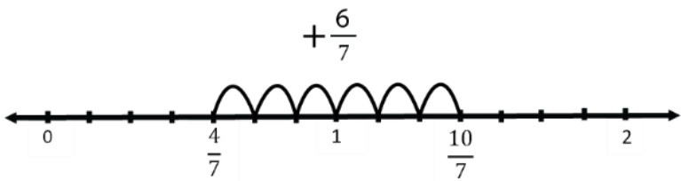

**Q2. Write the following fractions in ascending order. a.** $\frac{7}{10}, \frac{11}{15}, \frac{2}{5}$ b. $\frac{19}{24}, \frac{5}{6}, \frac{7}{12}$

Ans. a. $\frac { 2 } { 5 }   <   \frac { 7 } { 1 0 }   <   \frac { 1 1 } { 1 5 }$ b. $\frac{7}{12} < \frac{19}{24} < \frac{5}{6}$

**Q3. Write the following fractions in descending order. a.** $\frac{25}{16}, \frac{7}{8}, \frac{13}{4}, \frac{17}{32}$ b. $\frac{3}{4}, \frac{12}{5}, \frac{7}{12}, \frac{5}{4}$

Ans. a. $\frac{13}{4} > \frac{25}{16} > \frac{7}{8} > \frac{17}{32}$

b. $\frac{12}{5} > \frac{5}{4} > \frac{3}{4} > \frac{7}{12}$

## Section 7.8

**Page no. 177**

**Q. Try adding** $\frac { 4 } { 7 } + \frac { 6 } { 7 }$ **using a number line. Do you get the same answer?**

Ans.

$$
{ \frac { 4 } { 7 } } + { \frac { 6 } { 7 } }
$$

$$
\frac{4}{7} + \frac{6}{7} = \frac{10}{7} = 1 + \frac{3}{7}
$$

Yes, using a number line, the answer is same.

**Page no. 179**

**Section 7.8**

**Figure it out**

**Q1. Add the following fractions using Brahmagupta’s method:**

a.

$$
\frac{2}{7} + \frac{5}{7} + \frac{6}{7}
$$

b. $\frac { 3 } { 4 } { + } \frac { 1 } { 3 }$

$$
\frac { 2 } { 3 } + \frac { 5 } { 6 }
$$

$$
\frac { 2 } { 3 } + \frac { 2 } { 7 }
$$

$$
\frac{3}{4} + \frac{1}{3} + \frac{1}{5}
$$

$$
\mathsf { f } . { \frac { 2 } { 3 } }   +   { \frac { 4 } { 5 } }
$$

$$
\text{。 } \frac{4}{5}  +  \frac{2}{3}
$$

$$
\mathsf { h } . { \frac { 3 } { 5 } } \mathsf { + } { \frac { 5 } { 8 } }
$$

$$
\mathrm { i . }   \frac { 9 } { 2 }   +   \frac { 5 } { 4 }
$$

$$
\frac { 8 } { 3 } { + } \frac { 2 } { 7 }
$$

$$
\frac{3}{4} + \frac{1}{3} + \frac{1}{5}
$$

$$
\frac{2}{3} + \frac{4}{5} + \frac{3}{7}
$$

$$
\frac{9}{2} + \frac{5}{4} + \frac{7}{6}
$$