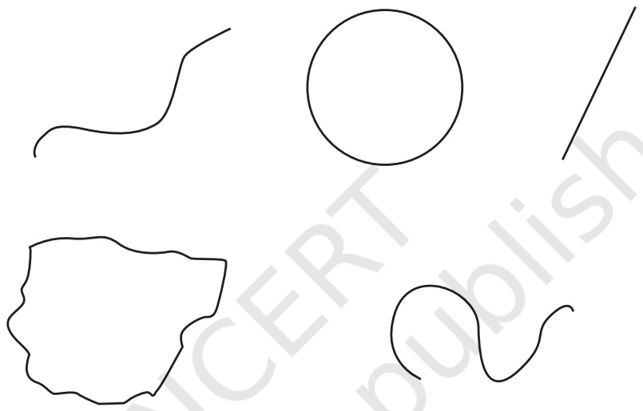
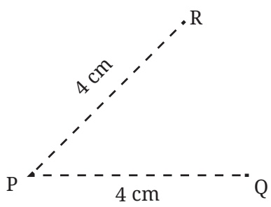

Now, arm yourself with a ruler and a compass. Let us explore if we can draw these figures with these tools and get familiar with a compass.

Observe the way a compass is made. What can one draw with the compass? Explore!

Do you know what curves are? They are any shapes that can be drawn on paper with a pencil, and include straight lines, circles and other figures as shown below:

Mark a point $\mathrm { ^ { \circ } P ^ { \prime } }$ in your notebook. Then, mark as many points as possible, in different directions, that are 4 cm away from P.

Think: Imagine marking all the points of 4 cm distance from the point P. How would they look?

Try to draw it and verify if it is correct by taking some points on the curve and checking if their distances from P are indeed 4 cm.

Explore, if you have not already done so, and see if a compass can be used for this purpose.

You can start by marking a few points of distance 4 cm from P using the compass. How can this be done?

