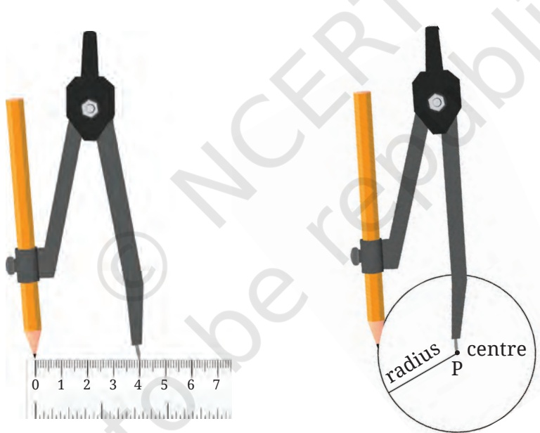

You will have to open up the compass against a ruler (see Fig. 8.2) such that the distance between the tip of the compass and the pencil is 4 cm.

## Now, try to get the full curve.

Hint: Keep the point of the compass fixed moving only the pencil.

What is the shape of the curve? It is a circle!

Take a point on the circle. What will be its distance from P—equal to 4 cm, less than 4 cm or greater than 4 cm? Similarly, what will be the distance between P and another point on the circle?

As shown in the figure, the point P is called the **centre** of the circle and the distance between the centre and any point on the circle is called the **radius** of the circle.

Fig. 8.2

Having explored the use of a compass, go ahead and recreate the images in Fig. 8.1.

Can you make the figures look as good as the figures shown there? Try again if you want to!

Also, has the use of instruments made the construction easier? Now try constructing the following figures.