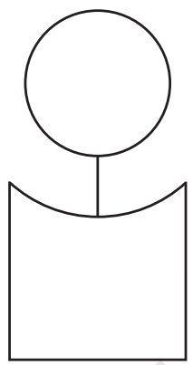
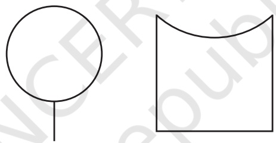
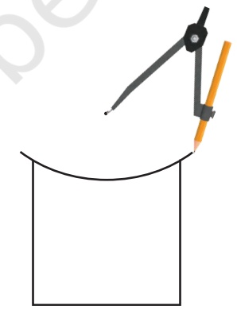

## 嶽 Construct

## 1. A Person

How will you draw this?

This figure has two components.

You might have figured out a way of drawing the first part. For drawing the second part, see this.

The challenge here is to find out where to place the tip of the compass and the radius to be taken for drawing this curve. You can fix a radius in the compass and try placing the tip of the