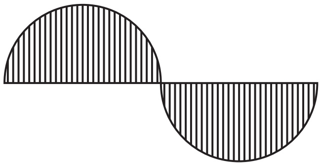
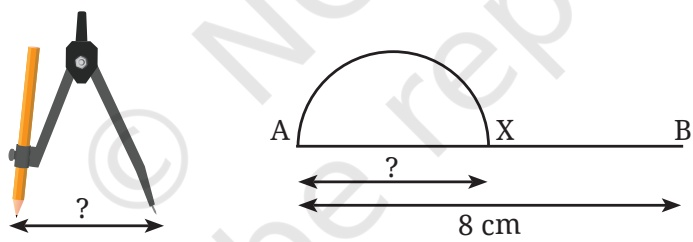
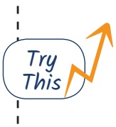

compass in different locations to see which point works for getting the curve. Use your estimate where to keep the tip.

## 2. Wavy Wave

Construct this.

As the length of the central line is not specified, we can take it to be of any length.

Let us take AB to be the central line such that the length of AB is 8 cm. We write this as $\mathrm { A B } = 8$ cm.

Here, the first wave is drawn as a half circle.

## Figure it Out

1. What radius should be taken in the compass to get this half circle? What should be the length of AX?

2. Take a central line of a different length and try to draw the wave on it.

3. Try to recreate the figure where the waves are smaller than a half circle (as appearing in the neck of the figure, ‘A Person’). The challenge here is to get both the waves to be identical. This may be tricky!

