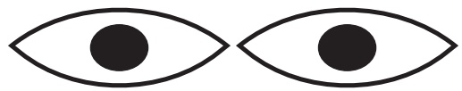
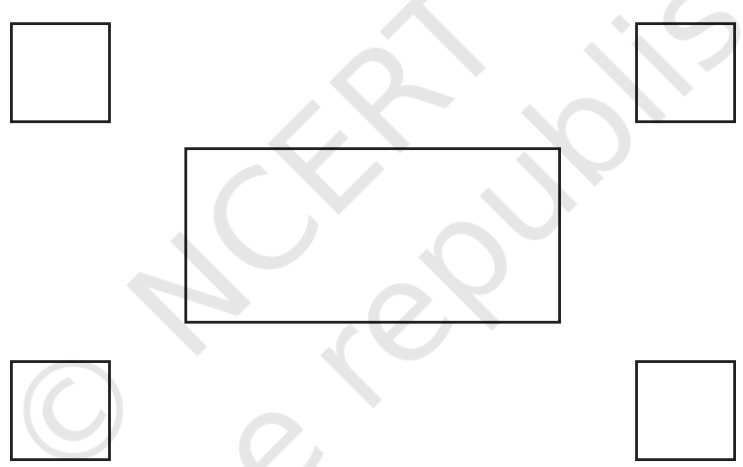
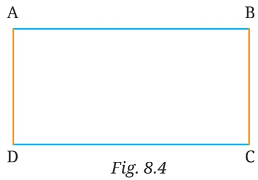

## 3. Eyes

How do you draw these eyes with a compass?

For a hint, go to the end of the chapter.

Make other artwork of your choice with a ruler and a compass.

## 8.2 Squares and Rectangles

Now, let us look at some basic figures having straight lines in their boundary.

Fig. 8.3

What shapes are these? Yes, these are our familiar squares and rectangles. But what makes them squares and rectangles?

Consider this rectangle ABCD.

The points A, B, C and D are the corners of the rectangle. Lines AB, BC, CD and DA are its sides. Its angles are $\angle \mathrm{A}, \angle \mathrm{B}, \angle \mathrm{C}$ and ∠D.

The blue sides AB and CD are called **opposite sides**, as they lie opposite to each other. Likewise, AD and BC is the other pair of opposite sides.

