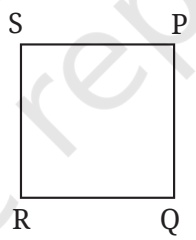
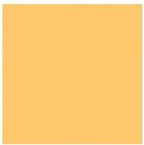
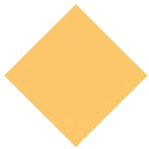

Recall that, in a rectangle:

R1) The opposite sides are equal in length, and

R2) All the angles are $9 0 ^ { \circ }$

As in the case of rectangles, the corners and sides are defined for a square in the same manner.

A square satisfies the following two properties:

S1) All the sides are equal, and

S2) All the angles are 90o.

See the rectangle in Fig. 8.4 and the name given to it: ABCD. This rectangle can also be named in other ways —BCDA, CDAB, DABC, ADCB, DCBA, CBAD and BADC. So, can a rectangle be named using any combination of the labels around its corners? No! For example, it cannot be named ABDC or ACBD. Can you see what names are allowed and what names are not?

In a valid name, the corners occur in an order of travel around the rectangle, starting from any corner.

Which of the following is not a name for this square?

1. PQSR

2. SPQR

3. RSPQ

4. QRSP

## Rotated Squares and Rectangles

Here is a square piece of paper having all its sides equal in length and all angles equal to $9 0 ^ { \circ }$ . It is rotated as shown in the figure. Is it still a square?

Let us check if the rotated paper still satisfies the properties of a square.

• Are all the sides still equal? Yes.

• Are all the angles still $9 0 ^ { \circ } ?$ Yes.