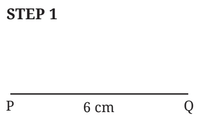
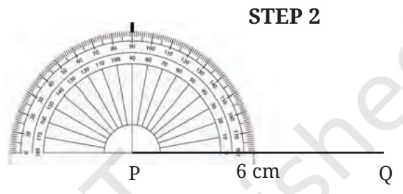
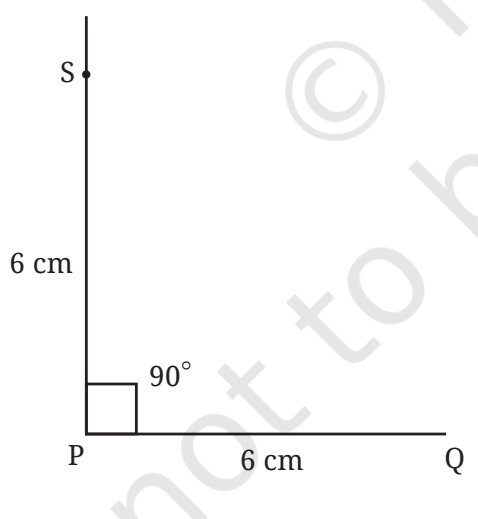

## 8.3 Constructing Squares and Rectangles

Now, let us start constructing squares and rectangles. How would you construct a square with a side of 6 cm?

For help, you can see the following figures. A square PQRS of side length 6 cm is constructed.

Mark a point to draw a perpendicular to PQ through P.

Step 3 Method 1

Mark S on the perpendicular such that PS = 6 cm using a ruler.

## Method 2

This can also be done using a compass.