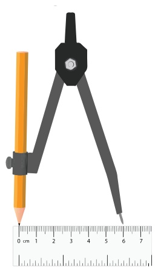
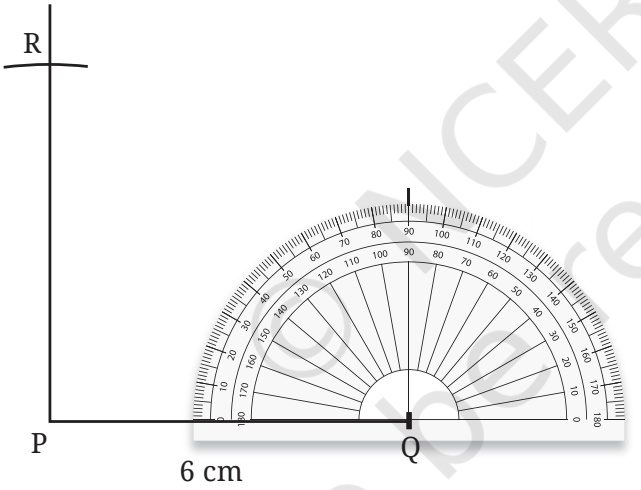
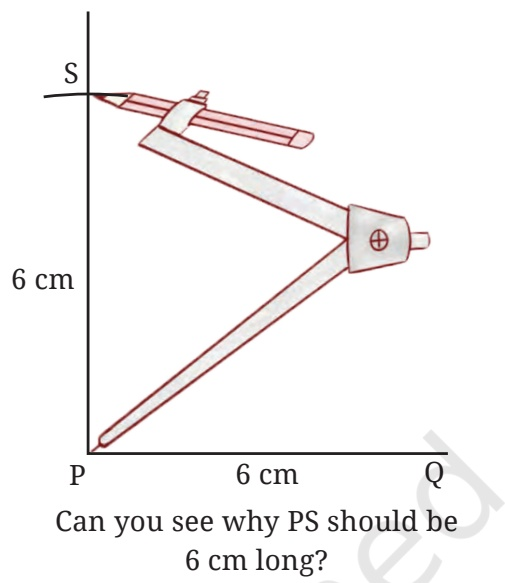
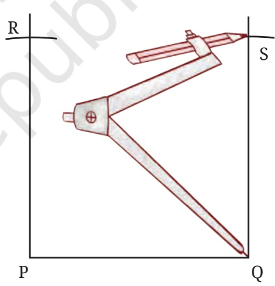
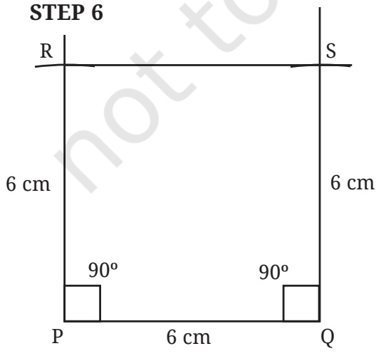

Step 4 Draw a perpendicular to line segment PQ through Q.

Step 5

If we had used the compass, then the next point can easily be marked using it!

How long is the side RS and what are the measures of $\angle \mathsf { R }$ and $\angle S ?$