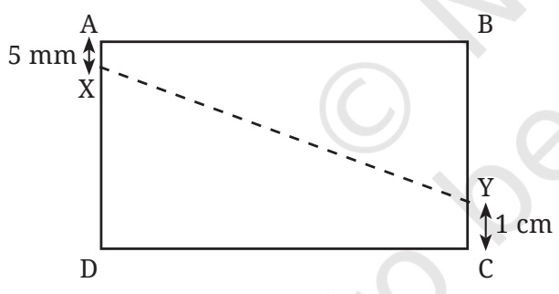
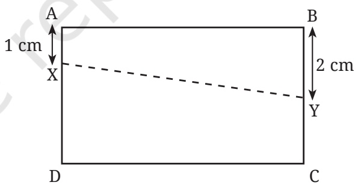
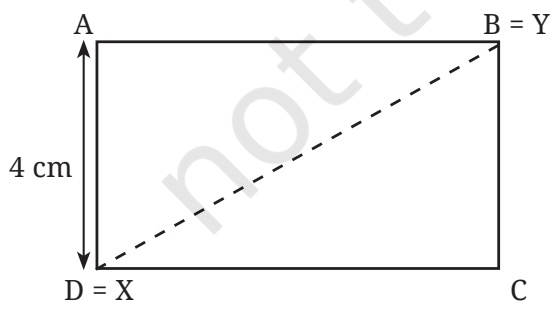
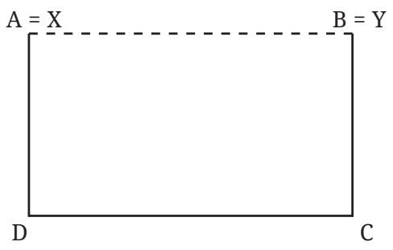

## Construct

1. Draw a rectangle with sides of length 4 cm and 6 cm. After drawing, check if it satisfies both the rectangle properties.

2. Draw a rectangle of sides 2 cm and 10 cm. After drawing, check if it satisfies both the rectangle properties.

3. Is it possible to construct a 4-sided figure in which—

• all the angles are equal to $9 0 ^ { \circ }$ but

opposite sides are not equal?

## 8.4 An Exploration in Rectangles

Construct a rectangle ABCD with AB = 7 cm and BC = 4 cm.

Imagine X to be a point that can be moved anywhere along the side AD. Similarly, imagine Y to be a point that can be moved anywhere along the side BC. Note that X can also be placed on the end point A or D. Similarly, Y can also be placed on the end point B or C.

