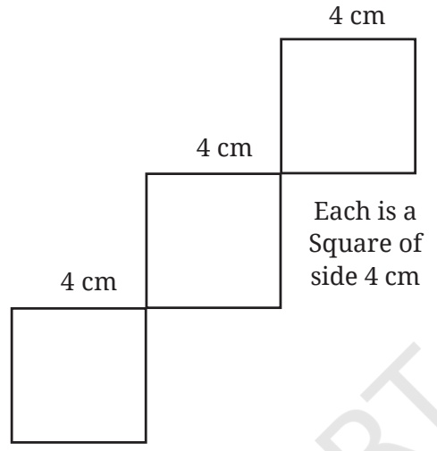
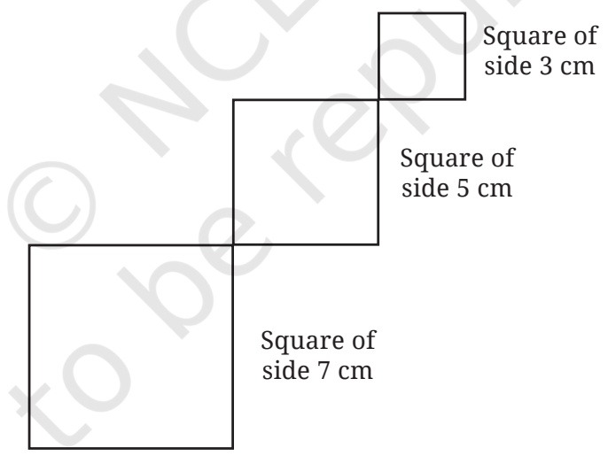
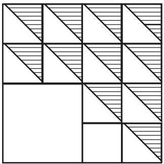

Hint: Draw a rough figure. What will be the sidelength of the square? What will be the distance between the corners of the square and the outer rectangle?

## 2. Falling Squares

Make sure that the squares are aligned the way they are shown.

Now, try this.

## 3. Shadings

Construct this. Choose measurements of your choice. Note that the larger 4-sided figure is a square and so are the smaller ones.

