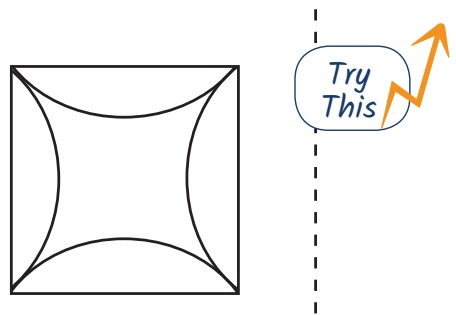
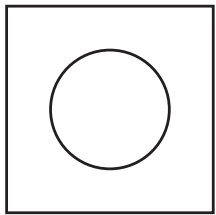
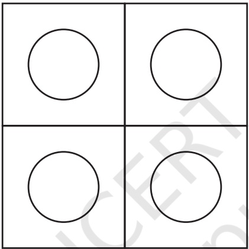
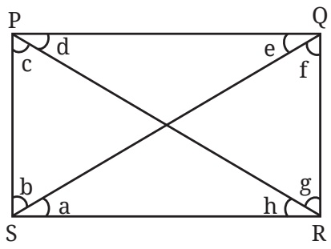

## 4. Square with a Hole

Observe that the circular hole is the same as the centre of the square.

Hint: Think where the centre of the circle should be.

## 5. Square with more Holes

## 6. Square with Curves

This is a square with 8 cm sidelengths.

Hint: Think where the tip of the compass can be placed to get all the 4 arcs to bulge uniformly from each of the sides. Try it out!

## 8.5 Exploring Diagonals of Rectangles and Squares

Consider a rectangle PQRS. Join PR and QS. These two lines are called the **diagonals** of the rectangle.

Compare the lengths of the diagonals. First predict the answer. Then construct a

