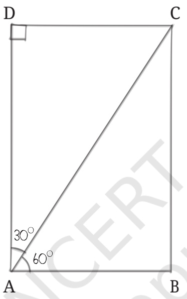
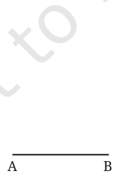
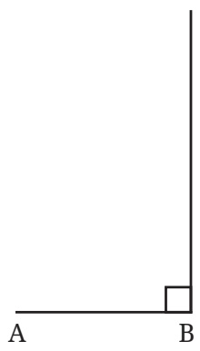

## Construct

1. Construct a rectangle in which one of the diagonals divides the opposite angles into $6 0 ^ { \circ }$ and $3 0 ^ { \circ }$

## Solution

Let us start with a rough diagram.

In what order should its parts be drawn? We will briefly sketch a possible order of construction.

## Step 1

AB is drawn with an arbitrary length. What is the next point that can be located?