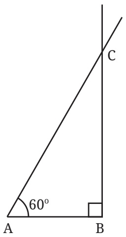
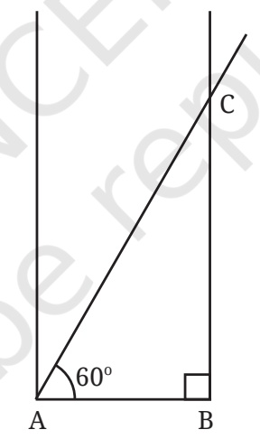

## Step 2

## Step 3

We know the line on which D lies. Draw a line through A perpendicular to AB.

Now $\angle \mathrm { A }$ is divided into two angles. One measures $6 0 ^ { \circ }$ . Check what the other angle is.

There are at least two ways of finding the point D —

One uses the fact that all the angles of a rectangle are right angles.

• The other uses the fact that opposite sides are equal.