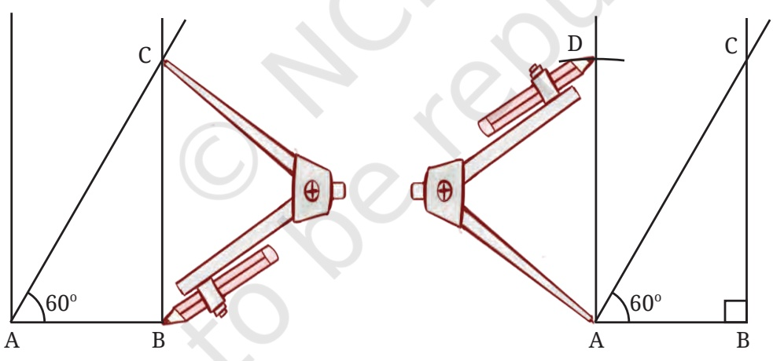
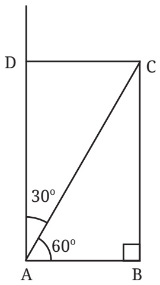

Step 4 Method 1

Draw a line perpendicular to BC at C to get the point D.

**Method 2**

Using a compass, mark the point D such that $\mathrm{AD} = \mathrm{BC}$ Join CD to get the required rectangle.

We have seen how to construct rectangles when their sides are given. But what do we do if a side and a diagonal is given?