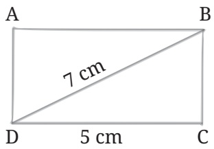
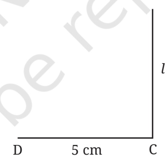

2. Construct a rectangle where one of its sides is 5 cm and the length of a diagonal is 7 cm.

## Solution

Let us draw a rough diagram.

Let us decide the steps of construction. Which line can be drawn first?

## Step 1

The base CD measuring length 5 cm can be easily constructed.

## Next?

## Step 2

Draw a perpendicular to line DC at the point C. Let us call this line l.

This is easy as we know that this line is perpendicular to the base. The point B should be somewhere on this line l.

嶽 How do we spot it? What else do we know about the position of B? We know that it is at a distance of 7 cm from the point D.