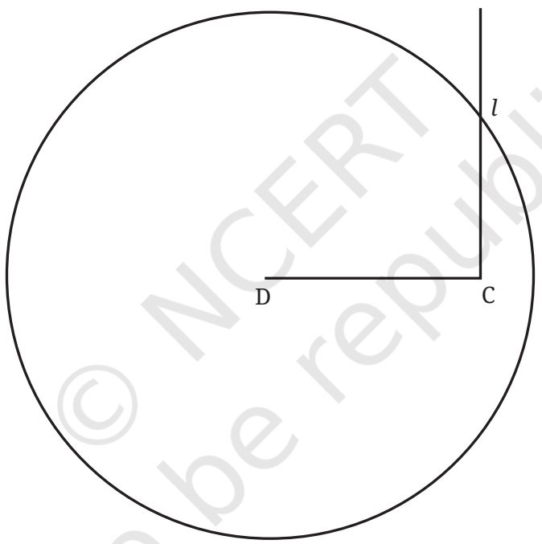

One of the ways of marking B is by taking a ruler and trying to move it around to get a point on line l that is 7 cm from point D. However, this requires trial and error. There is another efficient method which doesn’t involve trial and error.

For this, instead of trying to get that one required point of distance 7 cm from D, let us explore a way of getting all the points of distance 7 cm from D.

We know what this shape is!

## Step 3 Method 1

Construct a circle of radius 7 cm with point D as the centre.

Can you spot the point B here? Remember that it is 7 cm away from point D and on the line l.

Consider the point at which the circle and the line intersect. What is its distance from point D? If needed, check your figure. What do you observe?

The point where the circle intersects the line l is the required point B.