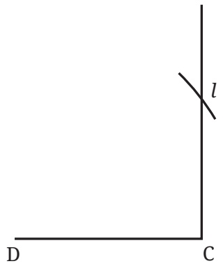
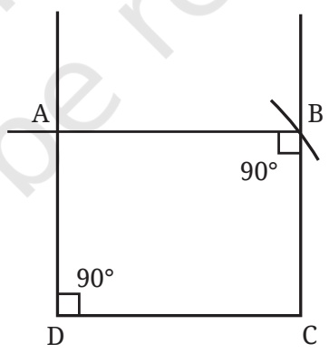

## Method 2

To locate the point B, was it necessary to draw the entire circle? We can see that only the arc near the line l is needed. So, the third step can also be done as shown in the figure below.

Having marked the three points of the rectangle, we only need to complete it. Recall that we were in a similar situation in the previous problem also. We saw two methods of completing the rectangle from here. We could follow any one of those methods.

## Step 4

Construct perpendiculars to DC and BC passing through D and B, respectively. The point where these lines intersect is the fourth point A.

Check if ABCD is indeed a rectangle satisfying properties R1 and R2.