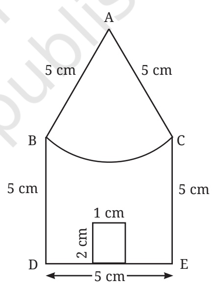
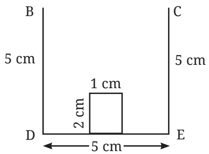

## Construct

1. Construct a rectangle in which one of the diagonals divides the opposite angles into $5 0 ^ { \circ }$ and $4 0 ^ { \circ }$

2. Construct a rectangle in which one of the diagonals divides the opposite angles into $4 5 ^ { \circ }$ and $4 5 ^ { \circ }$ . What do you observe about the sides?

3. Construct a rectangle one of whose sides is 4 cm and the diagonal is of length 8 cm.

4. Construct a rectangle one of whose sides is 3 cm and the diagonal is of length 7 cm.

## 8.6 Points Equidistant from Two Given Points

## 嶽 Construct

## House

Recreate this figure.

Note that all the lines forming the border of the house are of length 5 cm.

## Solution

The first task is to identify in what sequence the lines and curve will have to be drawn.

## Step 1

