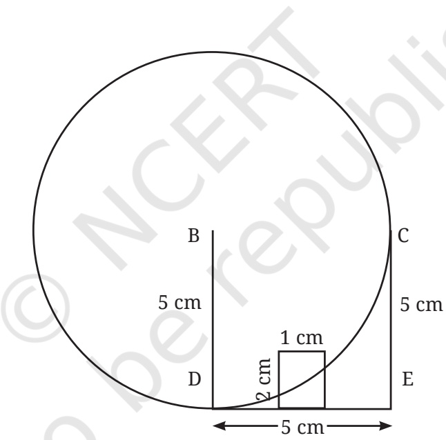

Can you complete the figure? Try!

We need to locate the point A that is of distance 5 cm from the points B and C. You might have realised that this can be done using a ruler. However, this leads to a lot of trial and error. This construction can be further simplified. How?

If you have guessed that this can be done by the use of compass, you are right! Go ahead and explore how the point A can be located without trial and error.

There is a similarity between the problem of finding point A in this problem and point B at step 3 of the second solved example of the previous section (see page 209).

## Step 2

Draw a curve that has all its points of 5 cm from the point B; the circle centred at B should be with 5 cm radius.

Does this help in spotting the point A? Construct and explore in the figure.

The point A can be located by finding the correct point on the circle that is of distance 5 cm from the point C. Again, this can be done using a ruler. But can we use a compass for this?