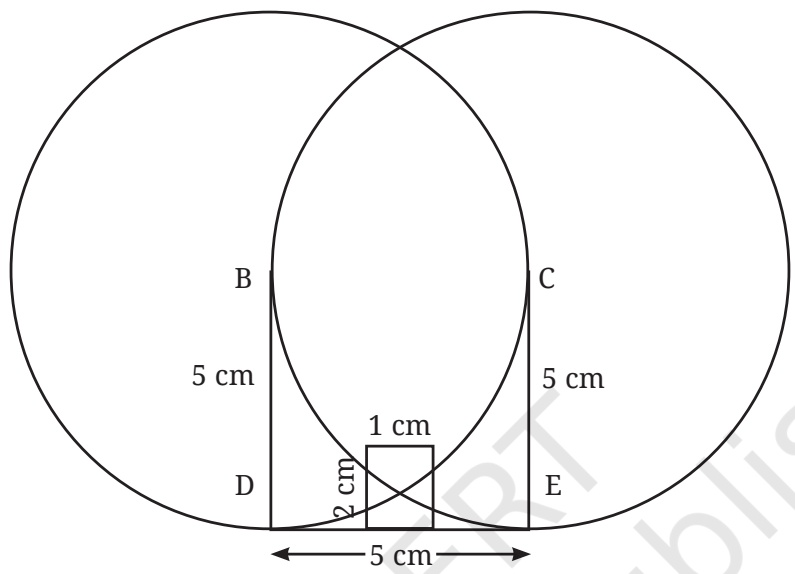

Step 3 Method 1

Take a radius of 5 cm in the compass and with C as the centre, draw a circle.

Are you able to spot the point A? Check the figure in your notebook. What do you observe?

See the point at which both the circles intersect. How far is it from the point B?

How far is it from C?

Thus, this is the point A!

## Think

Was it necessary to draw two full circles to get the point A? We only needed part of both the circles.

## Method 2

So the point A could have been obtained just by drawing arcs of radius 5 cm from points B and C.