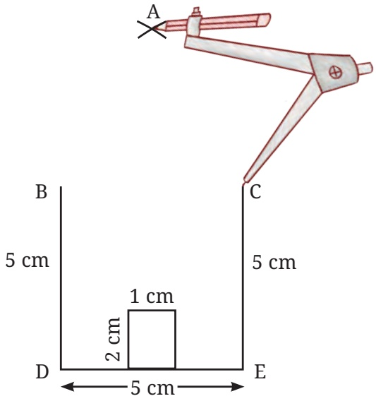
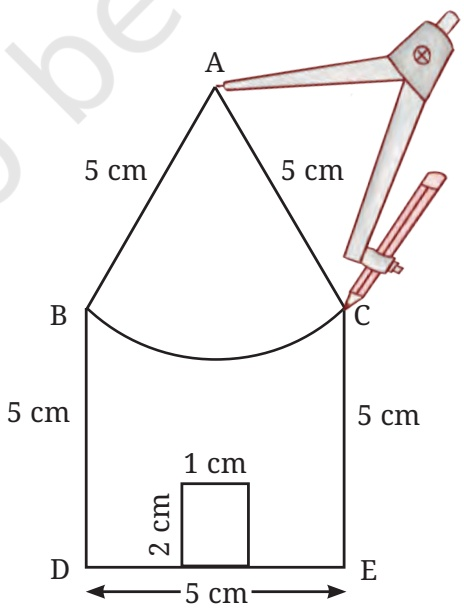

The house is ready!

Join A to B and A to C by straight lines.

Having obtained point A, what remains is the construction of the remaining arc. How do we do it? Can we use the fact that A is of distance 5 cm from both B and C?

## Step 4

Take 5 cm radius in the compass and from A, draw the arc touching B and C as shown in the figure.

