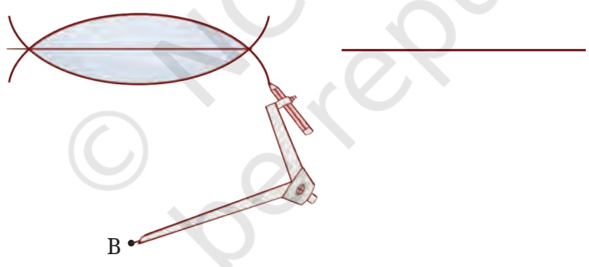

## Construct

1. Construct a bigger house in which all the sides are of length 7 cm.

2. Try to recreate ‘A Person’, ‘Wavy Wave’, and ‘Eyes’ from the section ‘Artworkʼ, using ideas involved in the ‘House’ construction.

3. Is there a 4-sided figure in which all the sides are equal in length but is not a square? If such a figure exists, can you construct it? Hints

**A) Eyes** (from 8.1 Artwork and Construct above (page no. 215).

Part of the construction is shown earlier. Observe it carefully. You will see two horizontal lines drawn lightly. In geometric constructions, one often constructs supporting curves or figures that are not part of the given figure but help in constructing it.

A

The technique to draw the upper and the lower curves of the eye is the same as that used in the figure, ‘A Personʼ. Points A and B are the locations where the tip of the compass is placed when drawing the curves of the eye. Note that the upper curve and the lower curve should together form a symmetrical figure. For this to happen, where should these points A and B be placed? Make a good estimate.