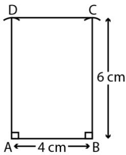
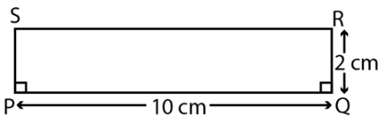

**Page no. 197 Section 8.3 Construct**

**Q.1. Draw a rectangle with sides of length 4 cm and 6 cm. After drawing, check if it satisfies both the rectangle properties.**

**Ans.** ∠A = ∠B = ∠C = ∠D = 90°

$$
AB = CD = 4   cm  \quad \&   AD  = BC = 6   cm .
$$

**Q.2. Draw a rectangle of sides 2 cm and 10 cm. After drawing, check if it satisfies both the rectangle properties.**

**Ans.**

$$
\angle \mathrm{P} = \angle \mathrm{Q} = \angle \mathrm{R} = \angle \mathrm{S} = 90^{\circ}
$$

$$
PQ = SR = 10  cm  \& PS = QR = 2  cm
$$

**Q.3. Is it possible to construct a 4-sided figure in which— • all the angles are equal to 90º but • opposite sides are not equal?**

Ans. No.

**Page no. 198 Section 8.4**

**Q. Is there a shorthand way of writing it down? In all the sentences, only the position of X, Y and the length XY changes. So we could write this as:**

| Distance of X from A | Distance of Y from B | Length of XY |
| --- | --- | --- |
|  |  |  |

**Ans.**

| Distance of X from A | Distance of Y from B | Length of XY |
| --- | --- | --- |
| 5 mm | 3 cm | 7.4 cm |
| 1 cm | 1 cm | 7 cm |
| 2 cm | 4 cm | 7.3 cm |