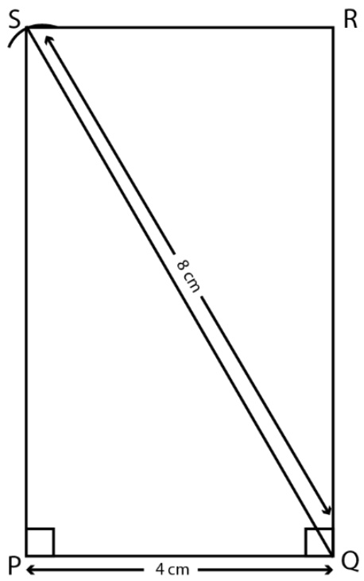
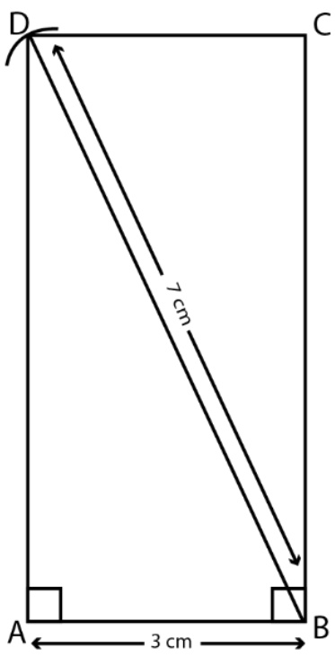

**Q.3. Construct a rectangle one of whose sides is 4 cm and the diagonal is of length 8 cm.** Ans.

**Q.4. Construct a rectangle one of whose sides is 3 cm and the diagonal is of length 7 cm.** Ans.

[6]