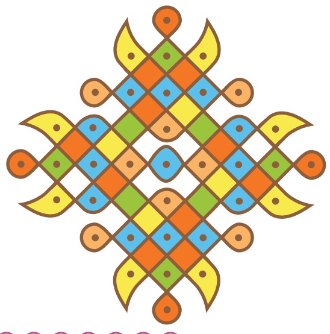
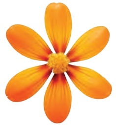
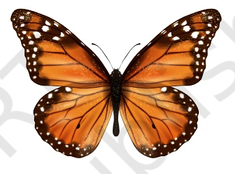
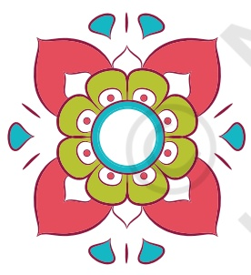

Look around you—you may find many objects that catch your attention. Some such things are shown below:

Flower

Butterfly

Rangoli

Pinwheel

There is something beautiful about the pictures above.

The flower looks the same from many different angles. What about the butterfly? No doubt, the colours are very attractive. But what else about the butterfly appeals to you?

In these pictures, it appears that some parts of the figure are repeated and these repetitions seem to occur in a definite pattern. Can you see what repeats in the beautiful rangoli figure? In the