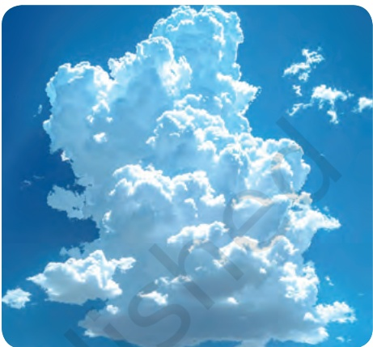
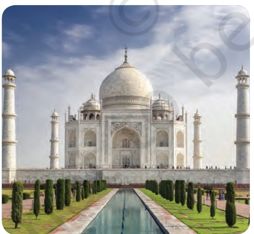
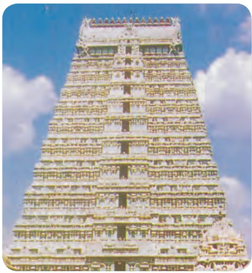

rangoli, the red petals come back onto themselves when the flower is rotated by $9 0 ^ { \circ }$ around the centre and so do the other parts of the rangoli.

What about the pinwheel? Can you spot which pattern is repeating? Hint: Look at the hexagon first.

Now, can you say what figure repeats along each side of the hexagon? What is the shape of the figure that is stuck to each side? Do you recognise it? How do these shapes move as you move along the boundary of the hexagon? What about the other pictures — what is it about those structures that appeals to you and what are the patterns in those structures that repeat?

Clouds

On the other hand, look at this picture of clouds. There is no such repetitive pattern.

We can say that the first four figures are symmetrical and the last one is not symmetrical. A symmetry refers to a part or parts of a figure that are repeated in some definite pattern.

Taj Mahal

Gopuram

What are the symmetries that you see in these beautiful structures?