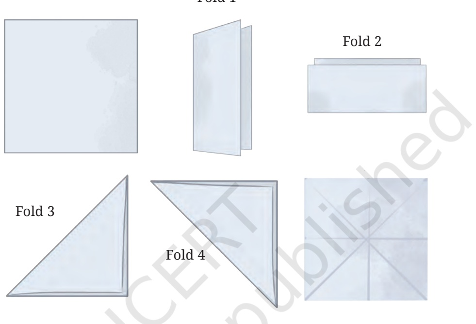
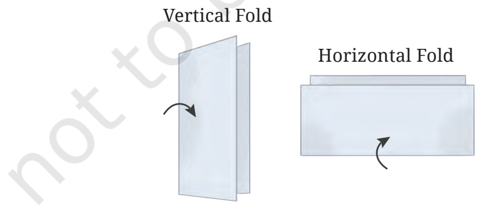

Horizontal Fold

Fold 1

Fold 2

## Figures with more than one line of symmetry

Does a square have only one line of symmetry? Take a square piece of paper. By folding, find all its lines of symmetry.

Fold 3

Fold 4

Here are the different folds giving different lines of symmetry.

• Fold the paper into half vertically.

Fold it again into half horizontally (i.e., you have folded it twice). Now open out the folds.

Vertical Fold

Again fold the square into half (for a third time now), but this time along a diagonal, as shown in the figure. Again, open it.