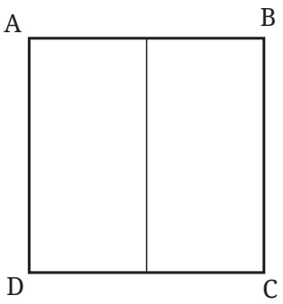

the square along this line, the points B, C on the right get reflected to the left side and occupy the positions occupied earlier by A, D. What happens to the points A, D? A occupies the position occupied by B and D that of C!

What if we reflect along the diagonal from A to C? Where do points A, B, C and D go? What if we reflect along the horizontal line of symmetry?

A figure that has a line or lines of symmetry is thus, also said to have **reflection symmetry**.

## Generating shapes having lines of symmetry

So far we have seen symmetrical figures and asymmetrical figures. How does one generate such symmetrical figures? Let us explore this.

## Ink Blot Devils

You enjoyed doing this earlier in Class 5. Take a piece of paper. Fold it in half. Open the paper and spill a few drops of ink (or paint) on one half.

Now press the halves together and then open the paper again.

• What do you see?

• Is the resulting figure symmetric?

If yes, where is the line of symmetry?

Is there any other line along which it can be folded to produce two identical parts?

• Try making more such patterns.