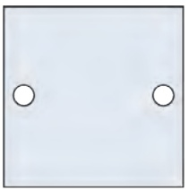
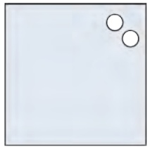
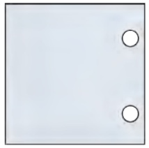
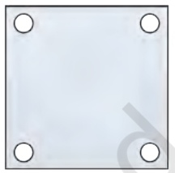
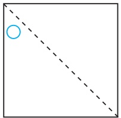
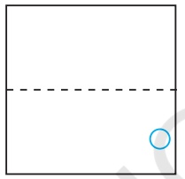
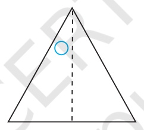
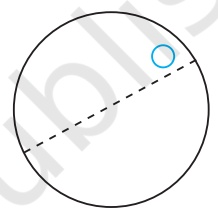
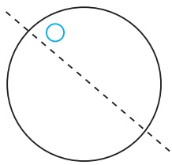
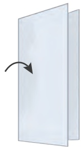

1. In each of the following figures, a hole was punched in a folded square sheet of paper and then the paper was unfolded. Identify the line along which the paper was folded.

Figure (d) was created by punching a single hole. How was the paper folded?

a.

b.

c.

d.

2. Given the line(s) of symmetry, find the other hole(s):

a.

b.

c.

d.

e.

3. Here are some questions on paper cutting. Consider a vertical fold. We represent it this way:

Vertical Fold

