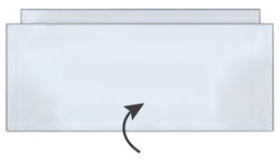
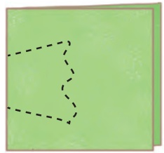
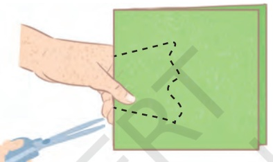
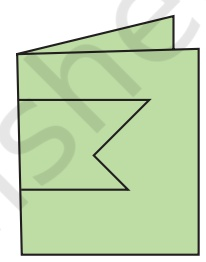
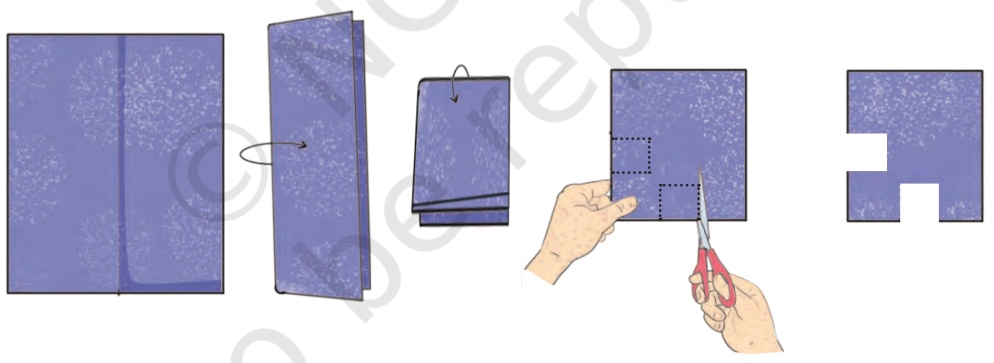
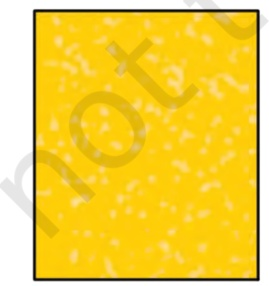
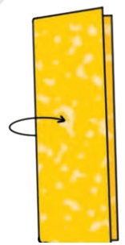
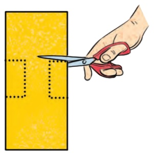
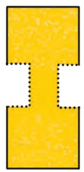

Similarly, a horizontal fold is represented as follows:

Horizontal Fold

4. After each of the following cuts, predict the shape of the hole when the paper is opened. After you have made your prediction, make the cutouts and verify your answer.

a.

b.

c.

d.

