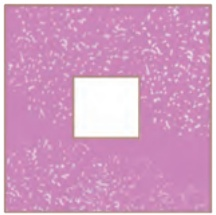
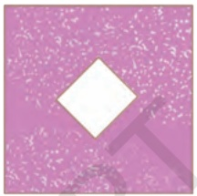
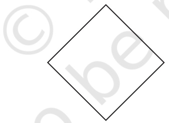
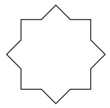
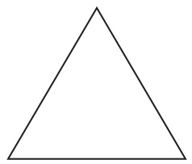

5 Suppose you have to get each of these shapes with some folds and a single straight cut. How will you do it?

a. The hole in the centre is a square.

b. The hole in the centre is a square.

Note: For the above two questions, check if the 4-sided figures in the centre satisfy both the properties of a square.

6. How many lines of symmetry do these shapes have? a.

b. A triangle with equal sides and equal angles.

