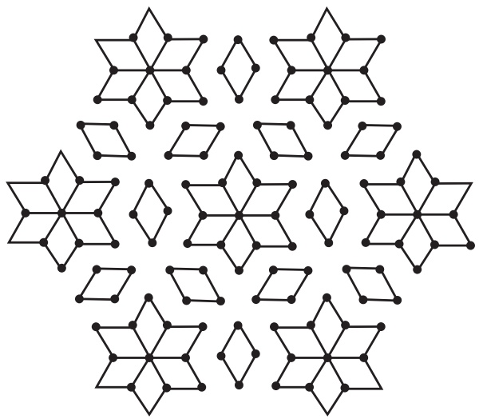
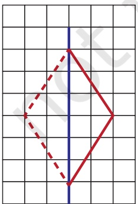
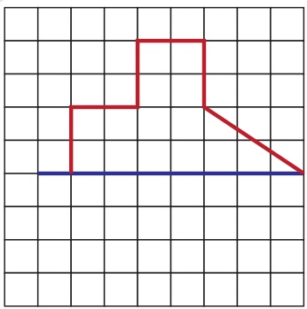
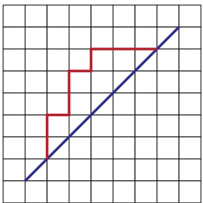

8. Find the lines of symmetry for the kolam below.

9. Draw the following.

a. A triangle with exactly one line of symmetry.

b. A triangle with exactly three lines of symmetry.

c. A triangle with no line of symmetry.

Is it possible to draw a triangle with exactly two lines of symmetry?

10. Draw the following. In each case, the figure should contain at least one curved boundary.

a. A figure with exactly one line of symmetry.

b. A figure with exactly two lines of symmetry.

c. A figure with exactly four lines of symmetry.

11. Copy the following on squared paper. Complete them so that the blue line is a line of symmetry. Problem (a) has been done for you.

(a)

(b)

(c)