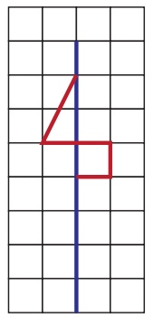
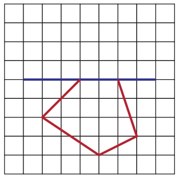
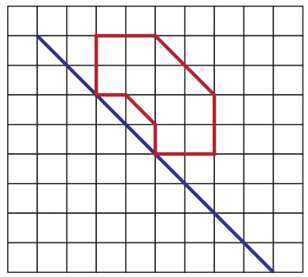
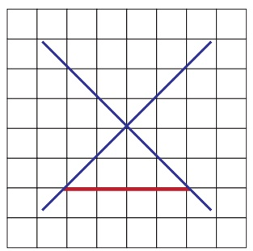
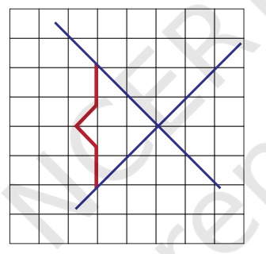
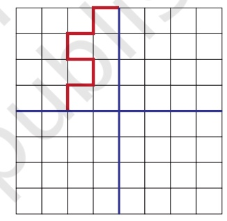
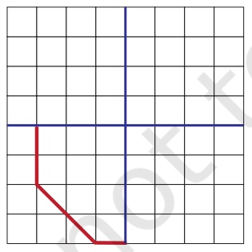
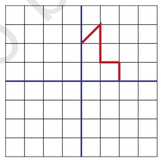
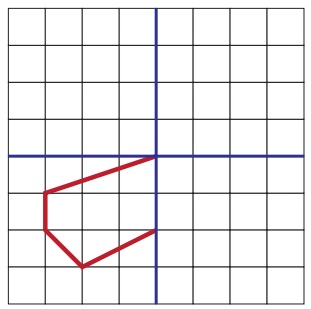

(d)

(e)

(f )

Hint: For (c) and (f), see if rotating the book helps!

12. Copy the following drawing on squared paper. Complete each one of them so that the resulting figure has the two blue lines as lines of symmetry.

(a)

(b)

(c)

(d) D

(e) E

(f)F