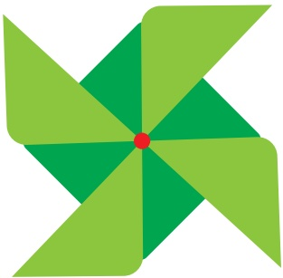

13. Copy the following on a dot grid. For each figure draw two more lines to make a shape that has a line of symmetry.

$$
\begin{array} { c c c c } { \cdots } & { \cdots } & { \cdots } & { \cdots } \\ { \cdots } & { \cdots } & { \cdots } & { \cdots } \\ { \cdots } & { \cdots } & { \cdots } & { \cdots } \\ { \cdots } & { \cdots } & { \cdots } & { \cdots } \\ { \cdots } & { \cdots } & { \cdots } & { \cdots } \\ \end{array}
$$

$$
\begin{array} { l l l l } { \cdots } & { \cdots } & { \cdots } & { \cdots } \\ { \cdots } & { \cdots } & { \cdots } & { \cdots } \\ { \cdots } & { \cdots } & { \cdots } & { \cdots } \\ { \cdots } & { \cdots } & { \cdots } & { \cdots } \\ { \cdots } & { \cdots } & { \cdots } & { \cdots } \\ { \cdots } & { \cdots } & { \cdots } & { \cdots } \\ \end{array}
$$

## 9.2 Rotational Symmetry

The paper windmill in the picture looks symmetrical but there is no line of symmetry! However, if you fold $\mathrm{i}\mathrm{t},$ the two halves will not exactly overlap. On the other hand, if you rotate it by $9 0 ^ { \circ }$ about the red point at the centre, the windmill looks exactly the same.

We say that the windmill has **rotational symmetry**.

When talking of rotational symmetry, there is always a fixed point about which the object is rotated. This fixed point is called the **centre of rotation**.

Will the windmill above look exactly the same when rotated through an angle of less than $9 0 ^ { \circ } ?$

No!

An angle through which a figure can be rotated to look exactly the same is called an **angle of rotational symmetry**, or just an **angle of symmetry**, for short.