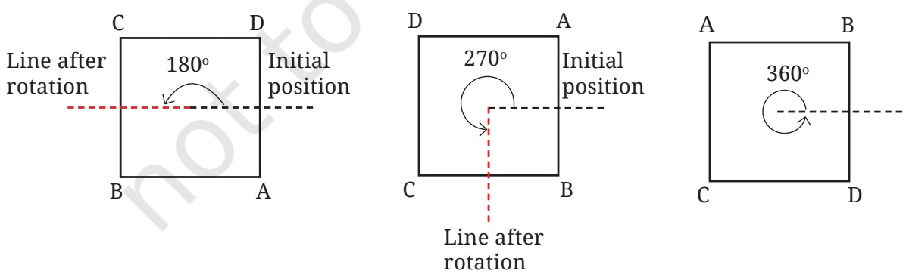
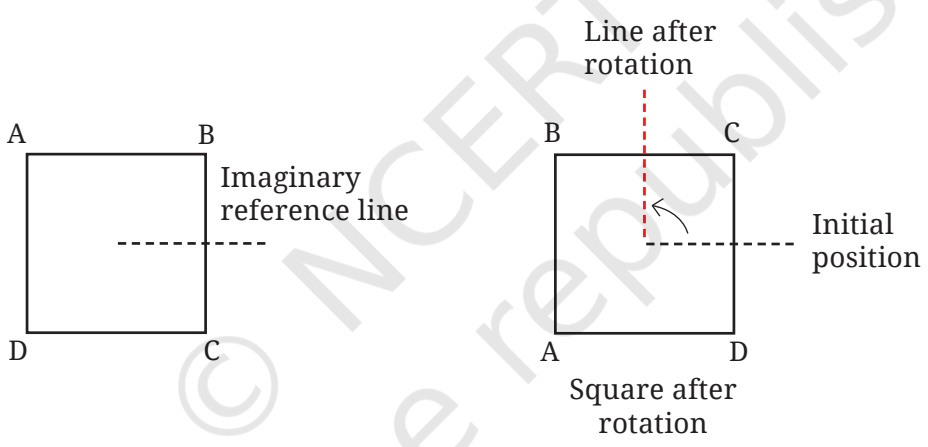

For the windmill, the angles of symmetry are $9 0 ^ { \circ }$ (quarter turn), $1 8 0 ^ { \circ }$ (half turn), $2 7 0 ^ { \circ }$ (three-quarter turn) and $3 6 0 ^ { \circ }$ (full turn). Observe that when any figure is rotated by $3 6 0 ^ { \circ }$ , it comes back to its original position, so $3 6 0 ^ { \circ }$ is always an angle of symmetry.

Thus, we see that the windmill has 4 angles of symmetry.

Do you know of any other shape that has exactly four angles of symmetry?

How many angles of symmetry does a square have? How much rotation does it require to get the initial square?

We get back a square overlapping with itself after $9 0 ^ { \circ }$ of rotation. This takes point A to the position of point B, point B to the position of point C, point C to the position of point D, and point D back to the position of point A. Do you know where to mark the centre of rotation?

What are the other angles of symmetry?