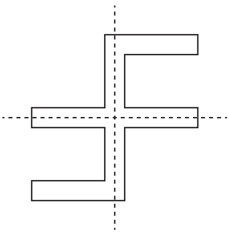
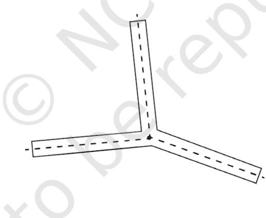

Here is one way:

We have seen figures having 4 and 2 angles of symmetry. Can we get a figure having exactly 3 angles of symmetry? Can you use radial arms for this?

Let us try with 3 radial arms as in the figure below. How many angles of symmetry does it have and what are they?

Here is a figure with three radial arms.

Trace and cut out a copy of this figure. By rotating the cutout over this figure determine its angles of rotation.

We see that only a full turn or a rotation of 360° will bring the figure back into itself. So this figure does not have rotational symmetry as 360 degrees is its only angle of symmetry.

However, can anything in the figure be changed to make it have 3 angles of symmetry?