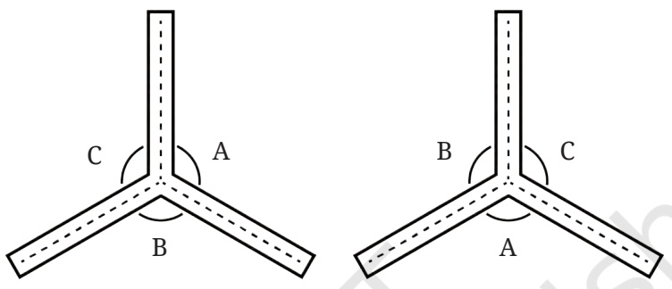
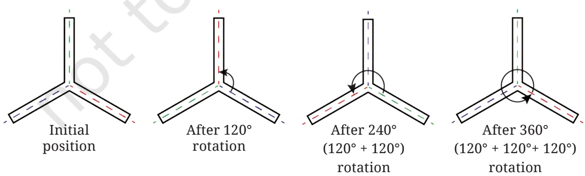

Note: The colours have been added to show the rotations.

Can it be done by changing the angles between the dotted lines?

If a figure with three radial arms should have rotational symmetry, then a rotated version of it should overlap with the original. Here are rough diagrams of both of them.

If these two figures must overlap, what can you tell about the angles?

Observe that $\angle \mathrm { A }$ must overlap $\angle \mathrm{B}; \angle \mathrm{B}$ must overlap $\angle 0$ and $\angle 0$ must overlap $\angle \mathrm { A }$

So, $\angle \mathrm{A} = \angle \mathrm{B} = \angle \mathrm{C},$ What must this angle be?

We know that a full turn has 360 degrees. This is equally distributed amongst these three angles. So each angle must be $\frac{360^{\circ}}{3} = 120^{\circ}$

So, the radial arms figure with 3 arms shows rotational symmetry when the angle between the adjacent dotted lines is $1 2 0 ^ { \circ }$ . Use paper cutouts to verify this observation.

Now how many angles of rotation does the figure have and what are they?

rotation

rotation