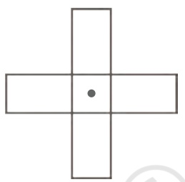
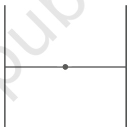
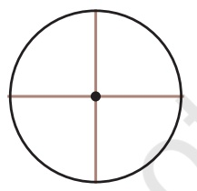
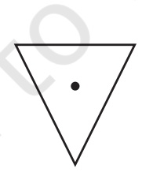
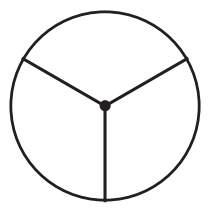
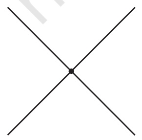

Let us explore more figures.

Can you draw a figure with radial arms that has a) exactly 5 angles of symmetry, b) 6 angles of symmetry? Also find the angles of symmetry in each case.

Hint: Use 5 radial arms for the first case. What should the angle between two adjacent radial arms be?

Consider a figure with radial arms having exactly 7 angles of symmetry. What will be its smallest angle of symmetry? Is the number of degrees a whole number in this case? If not, express it as a mixed fraction.

Let us find the angles of symmetry for other kinds of figures.

## Figure it Out

1. Find the angles of symmetry for the given figures about the point marked •.

(a)

(b)

(c)

symmetry?

