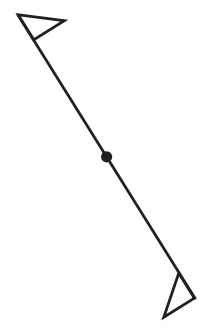
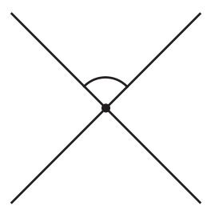
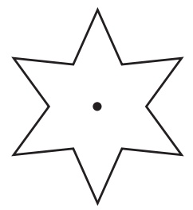
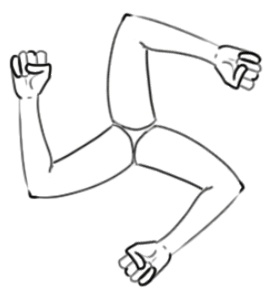
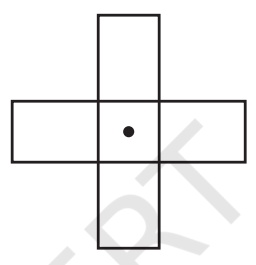
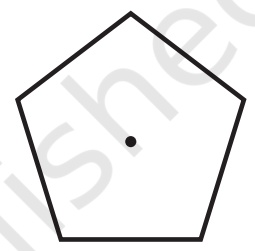

3. Give the order of rotational symmetry for each figure:

Let us list down the angles of symmetry for all the cases above.

• Angles of symmetry when there are exactly 2 of them: 180°, 360°.

• Angles of symmetry when there are exactly 3 of them: $1 2 0 ^ { \circ } ,$ $2 4 0 ^ { \circ } , 3 6 0 ^ { \circ }$

Angles of symmetry when there are exactly 4 of them: $9 0 ^ { \circ } ;$ 180°, 270°, 360°.

Do you observe something common about the angles of symmetries in these cases? The first set of numbers are all multiples of 180. The second are all multiples of 120. The third are all multiples of 90.

In each case, the angles are the multiples of the smallest angle. You may wonder and ask if this will always happen. What do you think?

## True or False

• Every figure will have 360 degrees as an angle of symmetry.