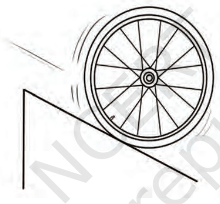
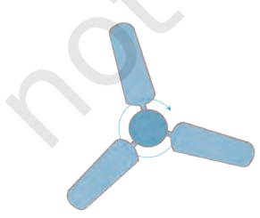
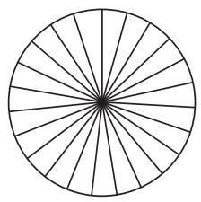

If the smallest angle of symmetry of a figure is a natural number in degrees, then it is **a factor** of 360.

Is there a smallest angle of symmetry for all figures? It turns out that this is the case for most figures, except for the most symmetric shapes like the circle, whose symmetries we now discuss.

## Symmetries of a circle

The circle is a fascinating figure. What happens when you rotate a circle clockwise about its centre? It coincides with itself. It does not matter what angle you rotate it by! So, for a circle, every angle is an angle of symmetry.

Now take a point on the rim of the circle and join it to the centre. Extend the segment to a diameter of the circle. Is that diameter a line of reflection symmetry? It is. Every diameter is a line of symmetry!

Like wheels, we can find other objects around us having rotational symmetry. Find them. Some of them are shown below:

Fan

Flower

Wheel