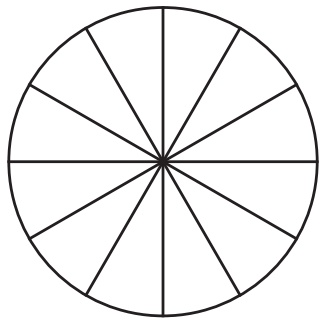
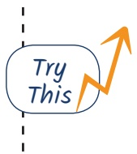

## Figure it Out

1. Colour the sectors of the circle below so that the figure has i) 3 angles of symmetry, ii) 4 angles of symmetry, iii) what are the possible numbers of angles of symmetry you can obtain by colouring the sectors in different ways?

2. Draw two figures other than a circle and a square that have both reflection symmetry and rotational symmetry.

3. Draw, wherever possible, a rough sketch of:

a. A triangle with at least two lines of symmetry and at least two angles of symmetry.

b. A triangle with only one line of symmetry but not having rotational symmetry.

c. A quadrilateral with rotational symmetry but no reflection symmetry.

d. A quadrilateral with reflection symmetry but not having rotational symmetry.

4. In a figure, $6 0 ^ { \circ }$ is the smallest angle of symmetry. What are the other angles of symmetry of this figure?

5. In a figure, $6 0 ^ { \circ }$ is an angle of symmetry. The figure has two angles of symmetry less than 60°. What is its smallest angle of symmetry?

6. Can we have a figure with rotational symmetry whose smallest angle of symmetry is:

a. $4 5 ^ { \circ } ?$

b. $1 7 ^ { \circ } ?$