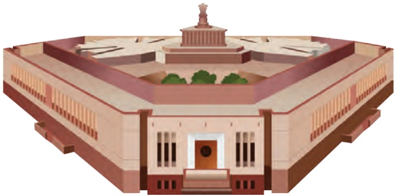
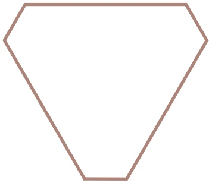

7. This is a picture of the new Parliament Building in Delhi.

a. Does the outer boundary of the picture have reflection symmetry? If so, draw the lines of symmetries. How many are they?

b. Does it have rotational symmetry around its centre? If so, find the angles of rotational symmetry.

8. How many lines of symmetry do the shapes in the first shape sequence in Chapter 1, Table 3, the Regular Polygons, have? What number sequence do you get?

9. How many angles of symmetry do the shapes in the first shape sequence in Chapter 1, Table 3, the Regular Polygons, have? What number sequence do you get?

10. How many lines of symmetry do the shapes in the last shape sequence in Chapter 1, Table 3, the Koch Snowflake sequence, have? How many angles of symmetry?

11. How many lines of symmetry and angles of symmetry does Ashoka Chakra have?

## Playing with Tiles

a. Use the colour tiles given at the end of the book to complete the following figure so that it has exactly 2 lines of symmetry.

b. Use 16 such tiles to make figures that have exactly:

1 line of symmetry

2 lines of symmetry

c. Use these tiles in making creative symmetric designs.