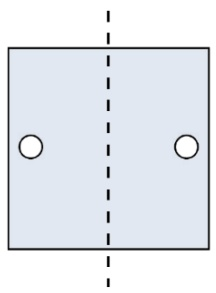
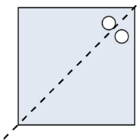
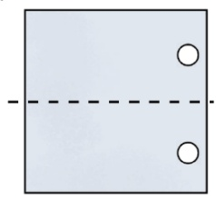
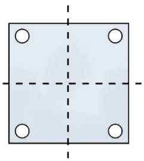
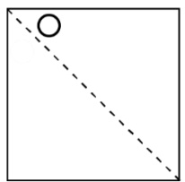
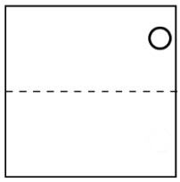
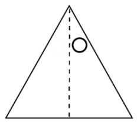
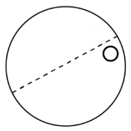
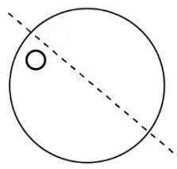
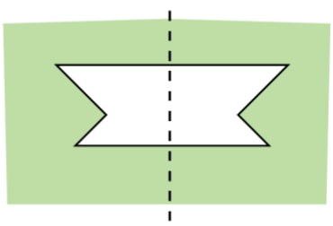

## Section 9.1

**Page no. 223**

**Q1 In each of the following figures, a hole was punched in a folded square sheet of paper and then the paper was unfolded. Identify the line along which the paper was folded.**

**Figure (d) was created by punching a single hole. How was the paper folded? Ans.**

a.

b.

C.

d.

For figure (d), paper was folded vertically and then horizontally or vice versa. **Q2. Given the line(s) of symmetry, find the other hole(s):**

**Ans.**

a.

b.

C.

d.

e.

**Q4. After each of the following cuts, predict the shape of the hole when the paper is opened. After you have made your prediction, make the cutouts and verify your answer.**

a.

b.

